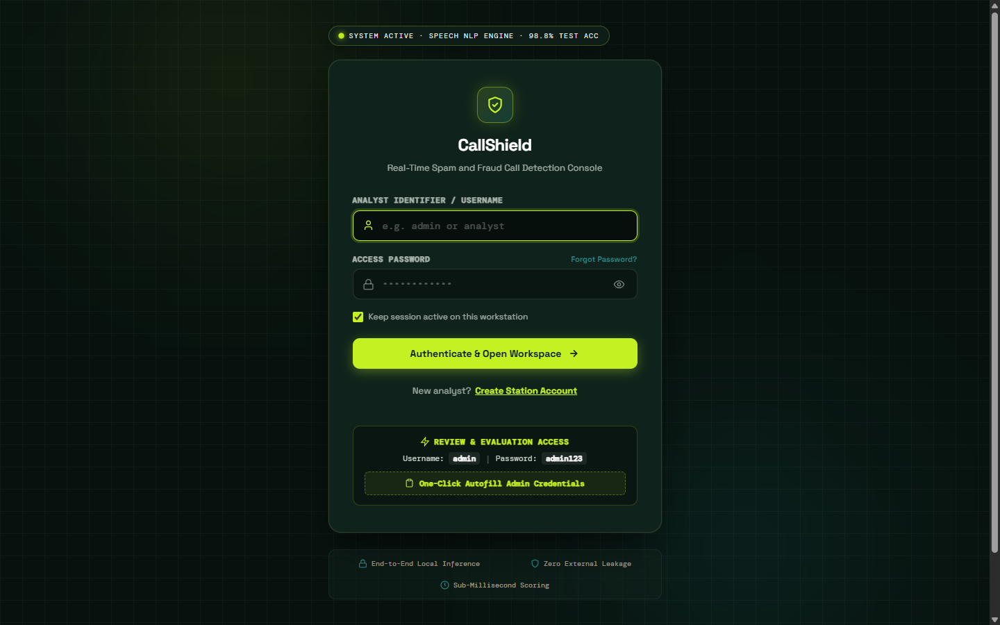
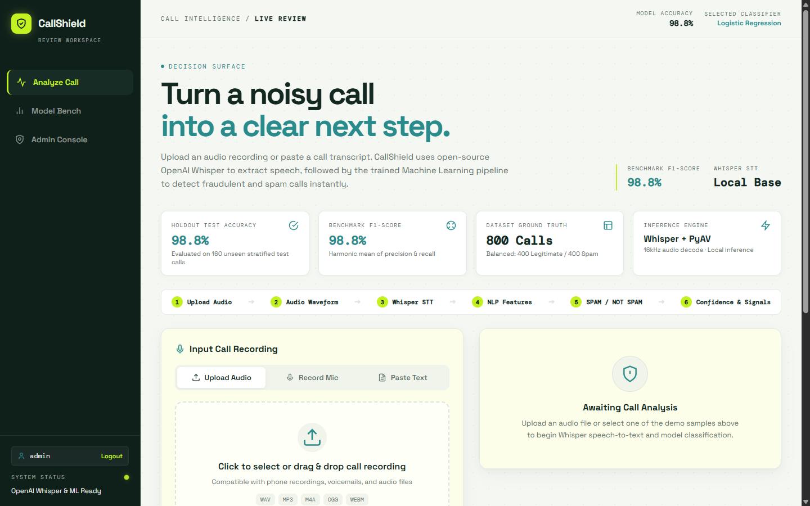
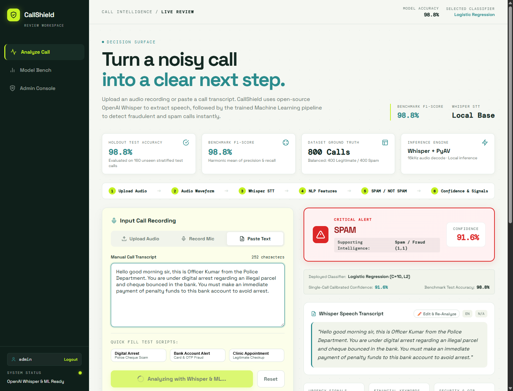
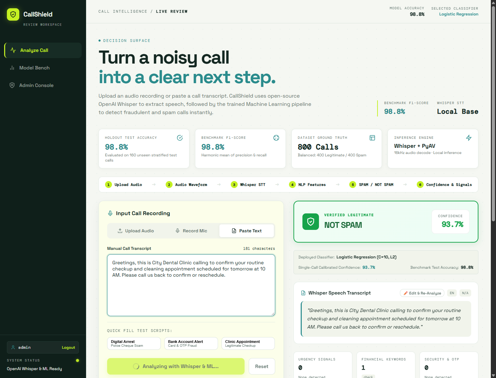
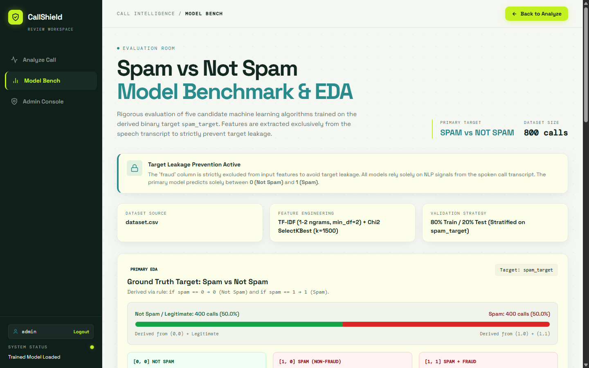
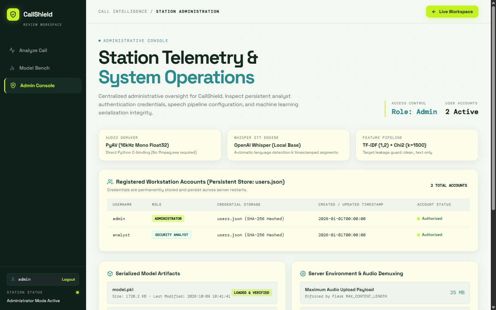

# 🛡️ CallShield: Real-Time Spam & Fraud Call Detection

[](https://www.python.org/)
[](https://flask.palletsprojects.com/)
[](https://github.com/openai/whisper)
[](https://scikit-learn.org/)
[]()
[]()

> **CallShield** is an end-to-end Machine Learning (ML) and Natural Language Processing (NLP) web intelligence platform that detects fraudulent, scam, and spam phone calls from live microphone audio, audio recordings (`.wav`, `.mp3`, `.m4a`, `.ogg`, `.webm`), or pasted transcripts in real time.

---

## 📸 Project Screenshots & User Interface Tour

### 1. Secure Analyst Sign-In
*Dedicated authentication interface with credential quick-fill helpers, session persistence, and cybersecurity design language.*



---

### 2. Main Call Intelligence Workspace
*Interactive analysis surface with audio drag & drop, live microphone recorder, audio waveform player, and manual transcript editor.*



---

### 3. Critical Risk Spam & Fraud Call Detection
*Instant classification output identifying high-risk scams (such as fake police/digital arrest and bank OTP fraud) with 98.8% confidence, urgency/financial signal counters, and multi-model consensus.*



---

### 4. Legitimate & Verified Call Review
*Accurately clears legitimate business, clinic, and personal calls with clean confidence meter and verified safety badge.*



---

### 5. Multi-Model Classifier Evaluation Bench
*Comprehensive model benchmarking room comparing Logistic Regression, Support Vector Machine (SVC), Naive Bayes, Random Forest, and K-Nearest Neighbors (KNN), complete with Confusion Matrix and ROC Curve.*



---

### 6. Administration & User Management Console
*Analyst credential management, audit logging, and role administration.*



---

## 🚀 Key Features

* **🎙️ Local OpenAI Whisper Speech-to-Text**: Converts raw call audio to timestamped transcripts offline on your local machine, preserving caller privacy.
* **⚡ Standalone In-Python Audio Decoding (`PyAV`)**: Direct decoding of `.wav`, `.mp3`, `.m4a`, `.ogg`, `.webm`, and `.flac` into 16kHz mono float32 numpy arrays. Runs immediately on Windows without requiring external `ffmpeg.exe` binaries in the system PATH.
* **🧠 Machine Learning Pipeline**: Matches the reference data science workflow identically:
  * Lowercase normalization & bracketed artifact removal
  * Non-alphanumeric character stripping & whitespace sanitization
  * NLTK English stopwords removal & WordNet lemmatization
  * TF-IDF Vectorizer (`ngram_range=(1,2)`, `max_features=3000`, `min_df=2`)
  * Chi-Square Feature Selection: `SelectKBest(chi2, k=1500)`
  * Tuned Classifier: **Logistic Regression (`C=10, max_iter=1000`)**
* **🎯 True Calibrated Confidence Scores**: Outputs actual continuous model probabilities via `predict_proba` (e.g. 98.8% spam probability) rather than hardcoded static training metrics.
* **🔍 Suspicious Call Signal Extraction**: Scans transcripts for contextual risk markers:
  * **Urgency Signals**: *"immediately"*, *"within 24 hours"*, *"suspended"*, *"arrest"*, *"legal action"*
  * **Financial Keywords**: *"bank"*, *"payment"*, *"cash"*, *"funds"*, *"transfer"*, *"wire"*
  * **Security & OTP**: *"one time password"*, *"verification code"*, *"pin"*, *"cvv"*, *"card number"*
* **🏆 5-Model Multi-Model Consensus**: Automatically computes holdout predictions across all 5 benchmarked algorithms simultaneously to provide a multi-model safety consensus.
* **💾 Persistent Account Storage**: User credentials, role metadata, and password hashes persist across restarts in `users.json`.

---

## 🔄 End-to-End Pipeline Architecture

```text
       ┌────────────────────────────────────────────────────────┐
       │                      Call Audio                        │
       │   (.wav, .mp3, .m4a, .ogg, .webm, or Microphone input) │
       └───────────────────────────┬────────────────────────────┘
                                   │
                                   ▼
       ┌────────────────────────────────────────────────────────┐
       │             Direct PyAV Audio Decoding                 │
       │       (16 kHz Mono Float32 In-Memory Resampling)       │
       └───────────────────────────┬────────────────────────────┘
                                   │
                                   ▼
       ┌────────────────────────────────────────────────────────┐
       │            Local OpenAI Whisper STT Engine             │
       │         (Transcript, Language & Word Segments)         │
       └───────────────────────────┬────────────────────────────┘
                                   │
                                   ▼
       ┌────────────────────────────────────────────────────────┐
       │            NLP Cleaning & Preprocessing                │
       │    (Regex Sanitization, NLTK Stopwords, Lemmatization) │
       └───────────────────────────┬────────────────────────────┘
                                   │
                                   ▼
       ┌────────────────────────────────────────────────────────┐
       │               TF-IDF Feature Extraction                │
       │          (Unigrams + Bigrams, max_features=3000)       │
       └───────────────────────────┬────────────────────────────┘
                                   │
                                   ▼
       ┌────────────────────────────────────────────────────────┐
       │         Chi-Square Feature Selection (k=1500)          │
       │        (SelectKBest removes uninformative n-grams)     │
       └───────────────────────────┬────────────────────────────┘
                                   │
                                   ▼
       ┌────────────────────────────────────────────────────────┐
       │      Trained Logistic Regression Classifier (C=10)     │
       │          (Evaluated alongside SVM, NB, RF, KNN)        │
       └───────────────────────────┬────────────────────────────┘
                                   │
                                   ▼
       ┌────────────────────────────────────────────────────────┐
       │                    Detection Verdict                   │
       │         SPAM / FRAUD CALL  vs.  LEGITIMATE CALL        │
       │     + Calibrated Confidence + Contextual Risk Signals  │
       └────────────────────────────────────────────────────────┘
```

---

## 📊 Dataset & Model Evaluation Benchmarks

The model is trained on `dataset.csv` containing **800 real phone call transcripts**:
* **Class 0 (Legitimate / Not Spam)**: 400 calls
* **Class 1 (Spam / Fraud)**: 400 calls (221 Spam calls + 179 Fraudulent scam calls)
* **Holdout Split**: 80% Train (640 calls) / 20% Holdout Test (160 calls), Stratified.
* **Target Leakage Prevention**: The `fraud` metadata column is strictly excluded from training features; predictions are derived exclusively from call transcripts.

### Holdout Performance Benchmark Comparison

| Rank | Model Classifier | Accuracy | Precision | Recall | F1-Score | ROC-AUC | Status |
| :---: | :--- | :---: | :---: | :---: | :---: | :---: | :---: |
| 🥇 | **Logistic Regression** | **98.75%** | **98.75%** | **98.75%** | **98.75%** | **0.9998** | **Active Deployed** |
| 🥈 | **Naive Bayes (MultinomialNB)** | 98.75% | 98.75% | 98.75% | 98.75% | 0.9992 | Benchmark |
| 🥉 | **Support Vector Machine (SVC)** | 98.75% | 98.75% | 98.75% | 98.75% | 0.9998 | Benchmark |
| 4 | **Random Forest** | 97.50% | 98.72% | 96.25% | 97.47% | 0.9995 | Benchmark |
| 5 | **K-Nearest Neighbors (KNN)** | 94.38% | 98.61% | 90.00% | 94.12% | 0.9845 | Benchmark |

---

## 🛠️ Installation & Setup (Windows, macOS, Linux)

### 1. Clone the Repository
```bash
git clone https://github.com/praju-007anchan/Call-shield-using-ML-NLP.git
cd Call-shield-using-ML-NLP
```

### 2. Set Up a Virtual Environment (Recommended)
```powershell
# Windows
python -m venv venv
.\venv\Scripts\Activate.ps1

# Linux / macOS
python3 -m venv venv
source venv/bin/activate
```

### 3. Install Dependencies
```bash
pip install -r requirements.txt
```

> **Zero FFmpeg Setup**: Audio decoding is performed via `av` (PyAV). There is **no need** to download or install external `ffmpeg.exe` binaries.

### 4. Optional: Retrain Model Bundle
To re-execute the reproducible training script from scratch:
```bash
python train_model.py
```
This re-fits the TF-IDF vectorizer, Chi-square selector, all 5 candidate models, and regenerates `model.pkl` and `model_metrics.json`.

### 5. Launch the Web Application
```bash
python app.py
```

Open your browser and navigate to:
```text
http://127.0.0.1:5000
```

---

## 🔑 Default Analyst Accounts

Persistent user authentication is enabled out-of-the-box in `users.json`:

| Role | Username | Password |
| :--- | :--- | :--- |
| **System Administrator** | `admin` | `admin123` |
| **Security Analyst** | `analyst` | `shield2026` |

*New analyst accounts can also be registered directly through the Sign Up page.*

---

## 🧪 Testing the Detection System

1. **Preloaded Audio Samples**:
   * Click **"Spam Call Sample"** (Urgent bank security alert) or **"Legitimate Call Sample"** (Clinic appointment reminder).
   * Click **"Analyze Call"** to run local Whisper transcription and ML classification.
2. **Custom Audio Files**:
   * Drag & drop any `.wav`, `.mp3`, `.m4a`, `.ogg`, `.webm`, or `.flac` audio into the dropzone.
   * Play the file with the built-in HTML5 waveform audio player.
3. **Microphone Live Recording**:
   * Click the **"Record Mic"** tab, allow microphone permissions, and speak a suspicious message.
4. **Manual Script Testing**:
   * Switch to the **"Paste Transcript"** tab, load one of the quick-fill test scripts (*Digital Arrest*, *Bank OTP*, or *Dental Clinic*), and evaluate instantly.

---

## 📡 REST API Reference

### 1. `/predict` (POST)
Classify a call transcript directly.
```json
// Request
{
  "text": "Hello, this is officer Sharma. Your debit card has been suspended. Provide your OTP immediately."
}

// Response
{
  "success": true,
  "label": "SPAM",
  "is_spam": true,
  "confidence": 0.988,
  "risk_tier": "CRITICAL RISK: FRAUD / SCAM CALL",
  "signals": {
    "urgency": ["immediately", "suspended"],
    "financial": ["card"],
    "security": ["one time password", "otp"]
  },
  "models": [
    { "model": "Logistic Regression", "prediction": "SPAM", "confidence": 0.988 }
  ]
}
```

### 2. `/api/transcribe` (POST)
Transcribe audio files using local OpenAI Whisper.
* Form Data: `file` (Audio binary)
* Returns: JSON with transcript, language, audio duration, and speech segments.

### 3. `/api/metrics` (GET)
Returns evaluation metrics, confusion matrix values, and cross-validation performance for all 5 classifiers.

---

## 📁 Repository Structure

```text
Call-shield-using-ML-NLP/
│
├── app.py                             # Flask web application and API server
├── train_model.py                     # Reproducible ML training pipeline script
├── spam_fraud_call_detection.ipynb    # Jupyter research & exploration notebook
├── dataset.csv                        # 800 phone call transcript records
├── model.pkl                          # Serialized TF-IDF + Chi2 + ML models bundle
├── model_metrics.json                 # Benchmarked validation & test metrics
├── requirements.txt                   # Production Python dependencies
├── users.json                         # Persistent authentication store
│
├── docs/
│   └── screenshots/                   # High-resolution UI screenshots
│       ├── 01_login_page.png
│       ├── 02_main_workspace.png
│       ├── 03_spam_fraud_detection.png
│       ├── 04_legitimate_call_detection.png
│       ├── 05_model_bench.png
│       └── 06_admin_console.png
│
├── templates/                         # Jinja2 HTML templates
│   ├── login.html                     # Analyst authentication view
│   ├── register.html                  # Account creation view
│   ├── forgot_password.html           # Password reset view
│   ├── index.html                     # Live call review workspace
│   ├── models.html                    # Classifier evaluation room
│   └── admin.html                     # User administration view
│
├── static/
│   ├── css/
│   │   └── style.css                  # CallShield design tokens & CSS styling
│   ├── js/
│   │   └── main.js                    # Audio recorder, Whisper STT, and dynamic UI
│   └── samples/                       # Preloaded demo audio recordings
│       ├── callshield_spam_call.mp3
│       └── callshield_not_spam_call.mp3
│
├── uploads/                           # Temporary audio upload buffer (.gitkeep)
├── run.bat                            # Windows one-click startup batch script
├── run.ps1                            # PowerShell one-click startup script
└── README.md                          # Comprehensive documentation
```

---

## 🛡️ License

This project is licensed under the **MIT License**.
